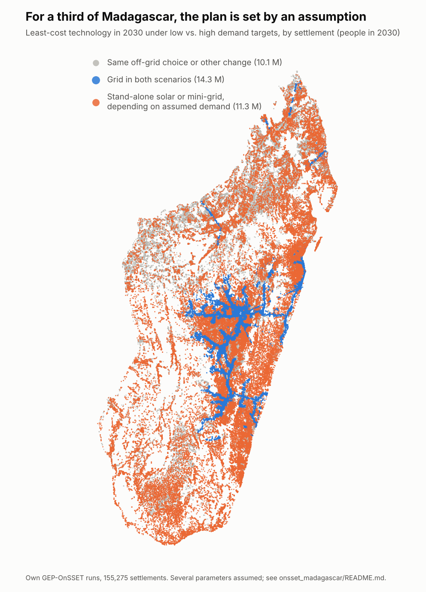

# Swarm electrification: replication, planning model and Madagascar baseline

Working repository for a possible PhD essay on bottom-up electrification pathways
(nanogrid → swarm grid → mini-grid). Everything here is a prototype built to find out
whether the research idea holds, not a finished model.

Start with **[`docs/research_gap.md`](docs/research_gap.md)**: what exists, where the gap
is, what the prototype shows, and what could sink the idea. Then
**[`docs/case_study.md`](docs/case_study.md)** for the paper's framework applied to two regions.

## Contents

| Folder | What it is | Status |
|---|---|---|
| `docs/research_gap.md` | Literature scan, ranked gaps, paper sequence, route to the MIT/Comillas group | First pass, not a systematic review |
| `docs/model.tex`, `model.pdf` | Formulation of the planning model | Matches the code |
| `replication/` | Julia replication of Ouanes et al. (2026), Energy Economics 163, 109598 | Reproduces the paper's pattern with synthetic inputs |
| `swarmplan/` | New model: network design, price-responsive demand, staged growth, hub upgrade, tariff cap | Prototype, illustrative parameters |
| `case_study/`, `docs/case_study.md` | The paper's decision framework applied to 2,075 settlements around Antongil Bay and Ambanja, with line costs added | Runs; representative clusters, not real layouts |
| `onsset_madagascar/` | GEP-OnSSET baseline for Madagascar, affordability and swarm screening scripts | Runs; several parameters assumed |

## Main findings so far

1. **Madagascar baseline.** Between a low and a high demand target, 11.25 million people
   (32 % of the 2030 population) flip from stand-alone solar to mini-grids, and investment
   rises from USD 3.8 bn to USD 12.2 bn.
2. **Replication.** The paper's profits under perfect competition are reproduced only if
   internal trade is priced at half the marginal value of energy; at the full value every
   nanogrid earns zero. Pure cost savings from interconnection are small (0.4–5.6 %).
3. **Why interconnect.** In the new model, lines are built only when poorer nanogrids
   cannot finance their own assets. Without budget limits no line pays, at any spacing
   tested.
4. **Market power.** With price-responsive demand, an unregulated single operator serves
   about a third of potential demand and builds about a third of the solar capacity.
5. **Staged growth.** A hub that feeds a swarm beats the classic mini-grid in every case
   tested. Waiting to centralise pays only when demand uncertainty is large and the hub is
   costly (at most about 8 % of cost); in most cases it gains nothing. That value
   disappears if nanogrid hardware is stranded when the hub arrives.
6. **Case study.** Applied to 2,075 real settlements, the paper's framework gives every
   settlement the same verdict: defer without budget limits, approve with them. Once line
   costs are added, demand level decides: at rural Tier 1 with a standard low-voltage line,
   93 % of people around Ambanja and 52 % around Antongil Bay are deferred; at Tier 3
   everything is approved.
7. **Calibration warning.** The paper's cost parameters imply energy at EUR 0.05–0.08/kWh
   against a tariff near EUR 2/kWh. Operating costs are missing.

## Run

Julia 1.10+ with JuMP, HiGHS, CSV, DataFrames (tested on 1.13):

    julia --project=. -e 'using Pkg; Pkg.instantiate()'
    cd replication && python make_inputs.py && julia --project=.. run_scenarios.jl && julia --project=.. breakeven.jl
    cd ../swarmplan && julia --project=.. test_sanity.jl
    julia --project=.. run_experiments.jl            # about 45 minutes with HiGHS on 2 cores

`onsset_madagascar/README.md` explains the OnSSET run. The large input and output files
are not in the repository.

## What is assumed

Load and solar profiles are synthetic stand-ins calibrated to the paper's figures. Line
costs, hub costs, scale economies, willingness-to-pay blocks, village geometry and several
OnSSET parameters are assumptions, marked `ASSUMED` in the code. Results show mechanisms
and orders of magnitude.
