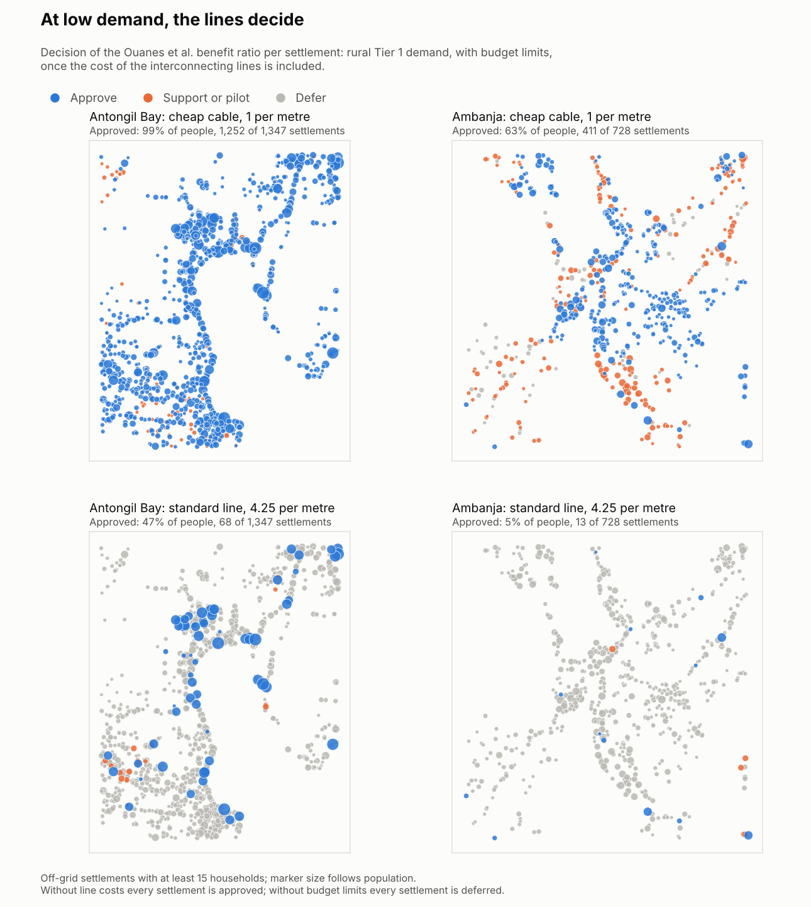

# Case study: the Ouanes et al. framework on 2,075 real settlements

*16 November 2026. Code in `case_study/`. Uses the two Madagascar OnSSET runs in
`onsset_madagascar/` and the replication of the paper's model in `replication/`.*

## Question

Ouanes et al. (2026) propose a decision framework for interconnecting nanogrids:
heterogeneity indexes, performance indicators, a benefit ratio and a rule that says
approve, support, pilot or defer. They demonstrate it on one hypothetical cluster of three
nanogrids. What does it say when applied to every sizeable off-grid settlement in a region?

Two regions, chosen for contrast:

- **Antongil Bay** (north-east, around Maroantsetra): no grid, low solar resource,
  sizeable agricultural demand in the OnSSET data, hydropower nearby.
- **Ambanja area** (north-west): where Nanoé, the paper's operator, works. High solar
  resource, partly grid-connected.

## Method in five steps

1. **Select settlements.** Off-grid in the OnSSET plan for 2030 and at least 15
   households: 1,347 around Antongil Bay and 728 around Ambanja in the low-demand run.
2. **Build a representative cluster per settlement.** Three household nanogrids of five
   households each, plus one anchor nanogrid carrying the settlement's productive and
   community demand. Two numbers from the data define it: ρ, the ratio of commercial,
   agricultural, health and education demand to residential demand, and the solar
   resource (GHI).
3. **Run the paper's model.** The framework is scale-free, so the model is solved once per
   (ρ, GHI) pair on a grid of 40 cases (`lookup.jl`) and scaled to each settlement's demand
   level (`apply_framework.py`). Three runs per case: isolated nanogrids, swarm without
   budget limits, swarm with budget limits in the paper's proportions.
4. **Compute the paper's quantities.** SDI, PDI, BHI, H_raw (weights 0.25, 0.25, 0.5);
   avoided investment; energy shared valued at EUR 0.30 per kWh; OPEX saving; social
   welfare; benefit ratio with a one-year horizon, which is what reproduces the paper's
   Table 9; then the paper's decision rule.
5. **Add the lines.** The paper leaves out the cost of interconnection. Here the cluster is
   connected by a tree whose segments have the settlement's nanogrid spacing, taken from
   its area and household count, at two unit costs: a cheap cable (1 per metre) and the
   GEP low-voltage line cost for Madagascar (4.25 per metre).

## The settlements

| | Antongil Bay | Ambanja |
|---|---|---|
| Settlements (low-demand run) | 1,347 | 728 |
| People in 2030 | 719,000 | 202,000 |
| Median households | 39 | 31 |
| Median nanogrid spacing | 55 m | 69 m |
| Solar resource, median GHI (kWh/m² per year) | 1,730 | 2,170 |
| Productive-to-residential demand ρ at Tier 1, median | 0.44 | 0.03 |
| OnSSET's choice at low demand | 89 % stand-alone solar | nearly all stand-alone solar |
| OnSSET's choice at high demand | mini-grids | 95 % mini-grids |

## Result 1: as published, the framework gives every settlement the same verdict

| Assumption | Median H_raw | Median benefit ratio | Decision |
|---|---|---|---|
| No budget limits | 0.08–0.11 | 0.07–0.40 | Defer: 100 % of settlements, both regions, both demand levels |
| Budget limits in the paper's proportions | 0.42–0.47 | 2.2–2.4 | Approve: 100 % of settlements, both regions, both demand levels |

The framework does not tell settlements apart. The answer is fixed by whether one assumes
that poorer nanogrids cannot finance their own equipment.

The reason is the energy-benefit term. With budget limits, 32–53 % of all energy is traded
between nanogrids. Each traded kWh is credited at EUR 0.30, while the model's hardware cost
is only EUR 0.05–0.07 per kWh. A third of the energy at 0.30 is already more than the whole
investment, so the ratio passes anywhere.

## Result 2: once lines cost money, demand level and geometry decide

Share of people in each decision class, with budget limits:

| Demand | Line cost | Antongil Bay | Ambanja |
|---|---|---|---|
| Low (rural Tier 1) | Cheap cable | 99 % approve | 63 % approve, 32 % support or pilot, 6 % defer |
| Low (rural Tier 1) | Standard line | 47 % approve, 52 % defer | 5 % approve, 93 % defer |
| High (rural Tier 3) | Either | 100 % approve | 100 % approve |

- At Tier 1 a cluster of 15 households needs hardware worth about EUR 34–43 a year, while
  the lines cost about EUR 77–96 a year: roughly two to three times the generation
  hardware. At Tier 3 the lines are about 8–13 % of hardware cost and stop mattering.
- With the standard line cost at low demand, the approvals are the towns: 68 of 1,347
  settlements around Antongil Bay (median 940 households) hold the 47 % of people. The
  typical village of 36 households is deferred.
- Antongil Bay does better than Ambanja despite a fifth less sun. Its settlements are
  denser, and agricultural demand is large relative to Tier 1 household demand, which
  raises load diversity (SDI 0.25 against 0.17; avoided investment 8 % against 1.3 %).

## What this means

1. **For the framework.** In its published form it is a test of one assumption, not a
   screening tool. To discriminate it needs line costs, and the value of shared energy
   should be tied to what that energy would otherwise have cost, not to a fixed EUR 0.30.
2. **For swarm grids.** Their case rests on demand reaching roughly Tier 2 to 3, or on
   interconnection hardware far cheaper than a standard low-voltage line. That matches
   practice: mesh-grid vendors use low-voltage DC cabling.
3. **For the research idea.** The interesting margin is the low-demand village that may or
   may not grow. That is the staged-investment question the planning model in `swarmplan/`
   is built for.

## Limits

- **Representative cluster, not real layouts.** Building positions are not in the data;
  spacing comes from settlement area on a 100 m raster.
- **Budget limits are the paper's proportions**, not measurements. No household wealth
  data was available.
- **Load shapes are synthetic stand-ins** for the paper's unpublished profiles; the anchor
  load is a daytime productive profile.
- **ρ relies on OnSSET's demand estimates**, including its agricultural demand layer. In
  the high-demand run the `Tier` column is 4 for some rural settlements; the verdict there
  does not depend on it.
- **Hardware-only costs**, as in the paper. With realistic operating costs every ratio
  falls.
- **Social welfare** is the paper's score for the matching scenario type, kept in
  proportion to system size. It moves the ratio by a few percent.
- The decision rule does not say what to do when the ratio is between 0.8 and 1 and
  heterogeneity is low; those cases are counted as defer. US dollars and euros are treated
  as equal.

## Reproduce

    cd case_study
    julia --project=.. lookup.jl                       # about 5 minutes
    python apply_framework.py <low_result.csv> <high_result.csv>
    python plot_case_study.py
